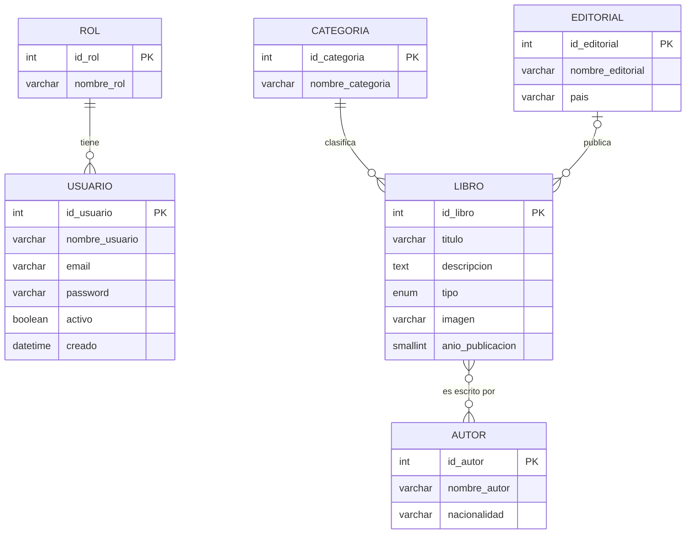

## Entidades y atributos

Las claves primarias están marcadas con **(PK)**.

| Entidad | Atributos |
|---|---|
| **Rol** | **id_rol (PK)**, nombre_rol |
| **Usuario** | **id_usuario (PK)**, nombre_usuario, email, password, activo, creado |
| **Categoría** | **id_categoria (PK)**, nombre_categoria |
| **Editorial** | **id_editorial (PK)**, nombre_editorial, pais |
| **Autor** | **id_autor (PK)**, nombre_autor, nacionalidad |
| **Libro** | **id_libro (PK)**, titulo, descripcion, tipo, imagen, anio_publicacion |

`Libro` representa cualquier artículo del catálogo: el atributo `tipo` indica si es un libro, una novela ligera, una revista o un audiolibro.

## Relaciones y cardinalidades

| Relación | Cardinalidad | Lectura |
|---|---|---|
| Rol **tiene** Usuario | 1 : N | Un rol puede tener muchos usuarios (o ninguno). Cada usuario tiene exactamente un rol. |
| Categoría **clasifica** Libro | 1 : N | Una categoría puede tener muchos libros (o ninguno). Cada libro pertenece a exactamente una categoría. |
| Editorial **publica** Libro | 1 : N | Una editorial puede publicar muchos libros (o ninguno). Cada libro tiene una editorial, o ninguna si no se conoce. |
| Libro **es escrito por** Autor | N : M | Un libro puede tener varios autores y un autor puede haber escrito varios libros. |

## Cómo leer el diagrama

- `||` significa "exactamente uno".
- `|o` significa "cero o uno".
- `o{` significa "cero o muchos".

Por ejemplo, `ROL ||--o{ USUARIO` se lee: *un rol tiene cero o muchos usuarios, y cada usuario tiene exactamente un rol*.
